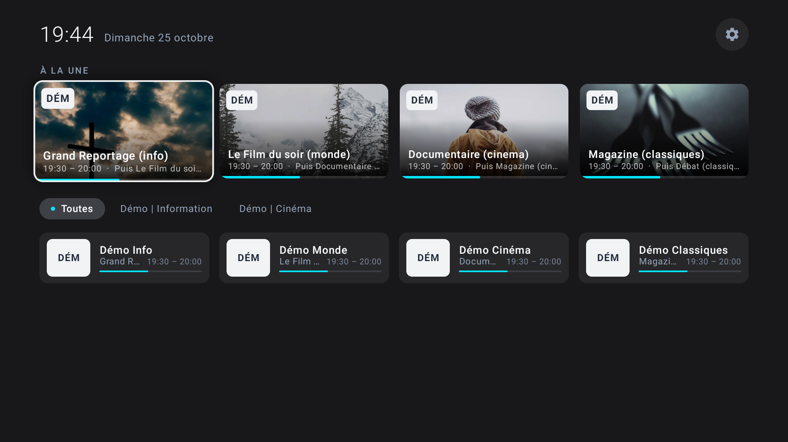
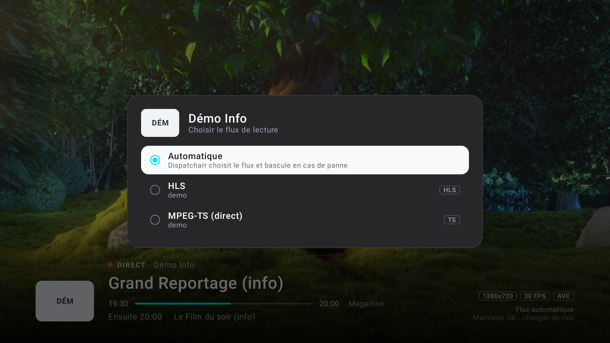

# Télé

> Version **0.1** — première version publique. Sur l'appareil, l'application s'appelle « TV ».

Lecteur IPTV pour **Android TV / Google TV**, pensé pour la télécommande : direct, guide des programmes et zapping rapide, dans une interface sobre.

Les chaînes viennent d'un serveur **[Dispatcharr](https://github.com/Dispatcharr/Dispatcharr)**, d'un abonnement **Xtream Codes** ou d'une **playlist M3U**.



## Fonctionnalités

- **Accueil** : 8 vignettes favorites avec le visuel du programme en cours, catégories et grille de chaînes (programme, horaires, progression).
- **Favoris** réorganisables sur la grille, **chaînes** et **catégories** masquables.
- **Lecteur** (Media3 / ExoPlayer, décodage matériel) :
  - zapping ↑ / ↓ et CH+ / CH− ;
  - bandeau d'informations : programme en cours et suivant, résolution, codecs ;
  - **volet des chaînes** (flèche ←) avec le guide, par-dessus le direct ;
  - nouvelles tentatives automatiques et messages d'erreur explicites.
- **Choix du flux** (appui long sur une chaîne, ou sur OK pendant la lecture) : flux Dispatcharr avec fournisseur et qualité, ou variantes TS / HLS en Xtream. Le choix est mémorisé par chaîne.
- **Guide EPG** :
  - Dispatcharr : grille du serveur, visuels et catégories des programmes ;
  - Xtream / M3U : guide XMLTV lu en flux (`.xml`, `.gz`, `.zip`), y compris celui annoncé par la playlist (`url-tvg`).
- **Écran d'accueil** « Bonjour / Bonsoir » avec le prénom du compte, affiché pendant le chargement.
- **Apparence** : 6 fonds dont un thème clair, 6 couleurs d'accent, 3 densités d'interface.



## Sources prises en charge

| Source | Saisie | Guide EPG |
|---|---|---|
| Dispatcharr | Adresse du serveur + clé API (`X-API-Key`) | Grille Dispatcharr (`/api/epg/grid/`) |
| Xtream Codes | Adresse, identifiant, mot de passe — ou lien `get.php?username=…&password=…` collé tel quel | `xmltv.php` du fournisseur |
| Playlist M3U / M3U8 | Lien de la playlist | Guide XMLTV saisi, sinon `url-tvg` de la playlist |

Seul le direct est géré : les films et séries (VOD) des playlists sont ignorés.

## Installation

### APK prêt à l'emploi

Téléchargez `tele-v0.1.apk` depuis la page [Releases](../../releases), puis installez-le sur la TV :

```bash
adb connect <ip-de-la-tv>:5555
adb install tele-v0.1.apk
```

Au premier lancement, ouvrez **Paramètres → Sources de chaînes → Ajouter une source**.

### Compiler depuis les sources

Prérequis : Android Studio (JDK 17+) et un appareil **Android TV 8.0+** (API 26).

```bash
git clone <url-du-dépôt>
cd IPTV-Player
./gradlew assembleDebug
```

Installation sur une TV en débogage réseau :

```bash
adb connect <ip-de-la-tv>:5555
adb install -r app/build/outputs/apk/debug/app-debug.apk
```

> La version debug est nettement plus lente que la version release (sur NVIDIA SHIELD : démarrage à froid en 4,0 s contre 0,6 s). Pour un usage quotidien, compilez la release signée :
>
> 1. créez une clé : `keytool -genkeypair -keystore release.jks -alias tele -keyalg RSA -keysize 4096 -validity 10000` ;
> 2. créez `keystore.properties` à la racine du projet :
>    ```properties
>    storeFile=release.jks
>    storePassword=…
>    keyAlias=tele
>    keyPassword=…
>    ```
> 3. lancez `./gradlew assembleRelease`, puis récupérez `app/build/outputs/apk/release/app-release.apk`.
>
> `*.jks`, `*.keystore` et `keystore.properties` sont exclus du dépôt.

## Télécommande

| Écran | Touche | Action |
|---|---|---|
| Accueil | OK | Regarder |
| Accueil | Appui long sur OK | Favoris, masquage, déplacement, choix du flux |
| Accueil | Appui long sur une catégorie | Masquer la catégorie |
| Lecteur | ↑ / ↓, CH+ / CH− | Chaîne précédente / suivante |
| Lecteur | ← | Volet des chaînes et du guide |
| Lecteur | OK, → ou Info | Bandeau d'informations |
| Lecteur | Appui long sur OK, ou Menu | Choix du flux |
| Lecteur | Lecture / Pause | Pause |
| Partout | Retour | Fermer le menu, puis revenir |

## Architecture

```
app/src/main/java/com/iptv/player/
├── MainActivity.kt          Activité unique, navigation, écran d'accueil
├── MainViewModel.kt         Chargement des chaînes et du guide selon la source active
├── data/
│   ├── model/               Chaîne, programme, source (SourceConfig)
│   ├── remote/              Clients Dispatcharr, Xtream, M3U, guide XMLTV, client HTTP partagé
│   ├── parser/              Lecture en flux des playlists M3U et des guides XMLTV
│   ├── epg/                 Programme en cours / suivant, heures locales
│   └── storage/             Réglages persistants (SharedPreferences)
├── playback/                Lecteur Media3 (OkHttp, reprises, infos techniques)
└── ui/                      Écrans et composants Jetpack Compose for TV
```

Choix techniques :

- **Un seul client OkHttp** partagé par l'API et le lecteur : les connexions TLS sont réutilisées d'un zapping à l'autre.
- **La clé API Dispatcharr** n'est envoyée qu'au serveur Dispatcharr, jamais au fournisseur vers lequel il redirige.
- **Playlists et guides lus en flux** : les playlists de plusieurs dizaines de milliers d'entrées et les guides de plusieurs dizaines de Mo ne sont pas chargés entièrement en mémoire. Seuls les programmes utiles (−3 h / +30 h) des chaînes connues sont conservés.
- **Cache local** des chaînes et du programme en cours, pour un accueil affiché sans attendre le réseau.
- **Journaux de performance** : `adb logcat -s TVPerf` (chargement, première image au zapping).

## Confidentialité

Les sources, clés API et mots de passe sont stockés **uniquement sur l'appareil**. L'application ne contient aucun serveur ni identifiant par défaut.

Les seules requêtes vers un service tiers sont les recherches d'affiches sur [TVMaze](https://www.tvmaze.com/api), et seulement quand la source ne fournit pas de visuel pour un programme. Ces requêtes contiennent uniquement le titre du programme.

## Avertissement

Cette application est un **lecteur** : elle ne fournit aucune chaîne ni aucun contenu. Utilisez-la uniquement avec des sources que vous êtes autorisé à regarder.

## Licence

Distribué sous licence [GNU GPL v3](LICENSE).

## Crédits

- Captures d'écran : *Big Buck Bunny* © Blender Foundation ([CC BY 3.0](https://creativecommons.org/licenses/by/3.0/)), visuels de démonstration [Lorem Picsum](https://picsum.photos).
- Bibliothèques : [AndroidX Media3](https://developer.android.com/media/media3), [Jetpack Compose for TV](https://developer.android.com/jetpack/androidx/releases/tv), [OkHttp](https://square.github.io/okhttp/), [Coil](https://coil-kt.github.io/coil/).
