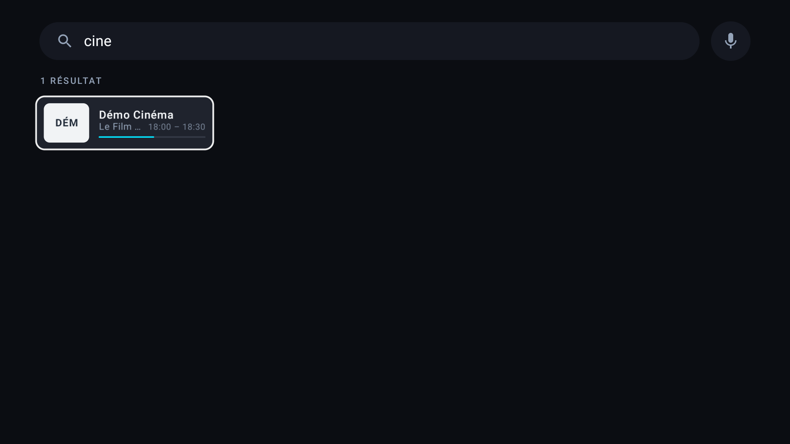
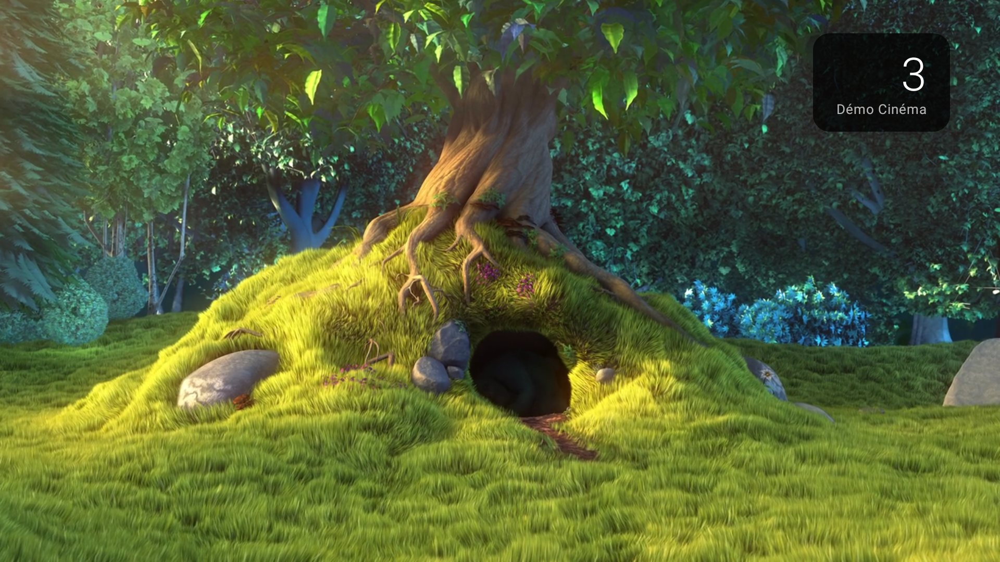

# Télé

IPTV player for **Android TV / Google TV**, designed for the remote: live TV, program guide and fast channel switching, in a clean interface. The interface is available in English and French.

Channels come from a **[Dispatcharr](https://github.com/Dispatcharr/Dispatcharr)** server, an **Xtream Codes** subscription or an **M3U playlist**.


## Features

- **Home**: 8 favorite tiles with the artwork of the current program, categories and channel grid (program, times, progress).
- **Channel preview** on the home screen: the channel selected for 2 seconds plays without sound in its tile (or in place of the logo in the grid), and keeps playing when opened (setting).
- Reorderable **favorites** on the grid, hideable **channels** and **categories**; categories can be **renamed** (hold OK on a category).
- **Several sources at once**: the channels of every enabled source are shown together; categories with the same name are merged or kept apart per source (setting).
- **Reference bouquet** (France: TNT + Canal+): channels are recognized whatever the provider spelling ("FR | TF1 FHD", "TF1 ᴴᴰ"), get their proper name, usual number and Canal+-style category, and their HD / FHD / 4K versions become one channel whose versions are its streams. Provider categories are cleaned and grouped by meaning ("Sport", "FR | Sports", "France Sport").
- **Search** by channel name, number or current program, typed with the TV keyboard or spoken (microphone button, or the remote's search key).
- **Player** (Media3 / ExoPlayer, hardware decoding):
  - channel switching with ↑ / ↓ and CH+ / CH−, or by typing the channel number with the remote digits (also from the home screen);
  - info banner: current and next program, resolution, codecs;
  - **channel panel** (← key) with the guide, over the live stream;
  - automatic reconnection when a stream drops (also when the network comes back), explicit error messages, OK to retry.
- **Stream picker** (long press on a channel, or OK during playback): Dispatcharr streams with provider and quality, or TS / HLS variants with Xtream. The choice is saved per channel.
- **Stream quality** setting (best, Full HD max, HD max or server order): with Dispatcharr, automatic mode plays the preferred quality first (resolution measured by Dispatcharr, else read from the stream name) and moves to the next stream if it fails.
- **EPG guide**:
  - Dispatcharr: server grid, program artwork and categories;
  - Xtream / M3U: XMLTV guide read as a stream (`.xml`, `.gz`, `.zip`), including the one announced by the playlist (`url-tvg`).
- **Welcome screen** "Good morning / Good evening" with the account first name, shown while loading.
- **Quick start guide** on the first launch: the main remote gestures in four pages, available again in **Settings → Help**.
- **Appearance**: 6 backgrounds including a light theme, 6 accent colors, 3 interface densities.
- **In-app updates**: the latest GitHub release is checked at launch (discreet dot on the settings button), then installed from **Settings → Updates** after the system confirmation.
- **Credentials encrypted** on the device with a key kept in the Android Keystore.

| Search | Channel number |
|---|---|
|  |  |


## Supported sources

| Source | Input | EPG guide |
|---|---|---|
| Dispatcharr | Server address + API key (`X-API-Key`) | Dispatcharr grid (`/api/epg/grid/`) |
| Xtream Codes | Address, username, password, or a `get.php?username=…&password=…` link pasted as is | Provider `xmltv.php` |
| M3U / M3U8 playlist | Playlist link | XMLTV guide entered, else the playlist `url-tvg` |

Only live TV is handled: movies and series (VOD) in playlists are ignored.

## Installation

### Ready-to-use APK

Download `tele-vX.Y.Z.apk` from the [Releases](../../releases) page, then install it on the TV:

```bash
adb connect <tv-ip>:5555
adb install tele-vX.Y.Z.apk
```

On first launch, open **Settings → Channel sources → Add a source**.

Later versions install from the app itself (**Settings → Updates**). The first time, Android asks to allow Télé to install apps.

Each pull request also builds a debug APK, available in the artifacts of its "Build APK" workflow run.

### Build from source

Requirements: [mise](https://mise.jdx.dev) (installs the JDK and the tooling from `mise.toml`), the Android SDK, and an **Android TV 8.0+** device (API 26).

```bash
git clone https://github.com/Sim7b/tele.git
cd tele
mise install
./gradlew assembleDebug
```

Install on a TV with network debugging:

```bash
adb connect <tv-ip>:5555
adb install -r app/build/outputs/apk/debug/app-debug.apk
```

> The debug build is much slower than the release build (on NVIDIA SHIELD: cold start in 4.0 s versus 0.6 s). For daily use, build a signed release:
>
> 1. create a key: `keytool -genkeypair -keystore release.jks -alias tele -keyalg RSA -keysize 4096 -validity 10000`;
> 2. create `keystore.properties` at the project root:
>    ```properties
>    storeFile=release.jks
>    storePassword=…
>    keyAlias=tele
>    keyPassword=…
>    ```
> 3. run `./gradlew assembleRelease`, then get `app/build/outputs/apk/release/app-release.apk`.
>
> `*.jks`, `*.keystore` and `keystore.properties` are excluded from the repository.

## Remote control

| Screen | Key | Action |
|---|---|---|
| Home | OK | Watch |
| Home | Long press on OK | Favorites, hiding, moving, stream picker |
| Home | Long press on a category | Hide the category |
| Player | ↑ / ↓, CH+ / CH− | Previous / next channel |
| Player | ← | Channel and guide panel |
| Player | OK, → or Info | Info banner |
| Player | Long press on OK, or Menu | Stream picker |
| Player | Play / Pause | Pause |
| Anywhere | Back | Close the menu, then go back |

## Architecture

```
app/src/main/java/io/github/sim7b/tele/
├── MainActivity.kt          Single activity, navigation, welcome screen
├── MainViewModel.kt         Loads channels and guide for the active source
├── data/
│   ├── model/               Channel, program, source (SourceConfig)
│   ├── remote/              Dispatcharr, Xtream, M3U and XMLTV guide clients, shared HTTP client
│   ├── parser/              Streaming readers of M3U playlists and XMLTV guides
│   ├── epg/                 Current / next program, local times
│   ├── storage/             Persistent settings (SharedPreferences)
│   └── UiText.kt            User-facing messages from the data layer, resolved in the UI locale
├── playback/                Media3 player (OkHttp, retries, technical info)
└── ui/                      Jetpack Compose for TV screens and components
```

Technical choices:

- **A single OkHttp client** shared by the API and the player: TLS connections are reused from one channel switch to the next.
- **The Dispatcharr API key** is only sent to the Dispatcharr server, never to the provider it redirects to.
- **Playlists and guides read as streams**: playlists of tens of thousands of entries and guides of tens of MB are never fully loaded in memory. Only useful programs (−3 h / +30 h) of known channels are kept.
- **Local cache** of channels and current programs, for a home screen shown without waiting for the network.
- **Performance logs**: `adb logcat -s TVPerf` (loading, first frame on channel switch).

## Development

- Tooling is pinned in `mise.toml` (JDK, Node for semantic-release, [prek](https://github.com/j178/prek)), with a 7-day minimum release age.
- Install the git hooks once: `prek install --install-hooks` (YAML, GitHub Actions security with zizmor, conventional commit messages).
- Tests and lint: `./gradlew testDebugUnitTest lintDebug`.
- Commits follow [Conventional Commits](https://www.conventionalcommits.org): on each push to `main`, [semantic-release](https://semantic-release.gitbook.io) computes the version (`feat`, `fix` and `perf` bump the patch number, breaking changes the minor one), updates `CHANGELOG.md` and `gradle.properties`, builds the signed APK and publishes the GitHub release.

## Privacy

Sources, API keys and passwords are stored **only on the device**, encrypted with a key that never leaves the Android Keystore. The app contains no server and no default credentials.

The only requests to a third-party service are poster searches on [TVMaze](https://www.tvmaze.com/api), and only when the source provides no artwork for a program. These requests only contain the program title. Update checks query the public GitHub API for the latest release of this repository and send no data about you or your sources.

## Disclaimer

This app is a **player**: it provides no channel and no content. Only use it with sources you are allowed to watch.

## License

Released under the [GNU GPL v3](LICENSE).

## Credits

- Screenshots: *Big Buck Bunny* © Blender Foundation ([CC BY 3.0](https://creativecommons.org/licenses/by/3.0/)), demo artwork from [Lorem Picsum](https://picsum.photos).
- Libraries: [AndroidX Media3](https://developer.android.com/media/media3), [Jetpack Compose for TV](https://developer.android.com/jetpack/androidx/releases/tv), [OkHttp](https://square.github.io/okhttp/), [Coil](https://coil-kt.github.io/coil/).
